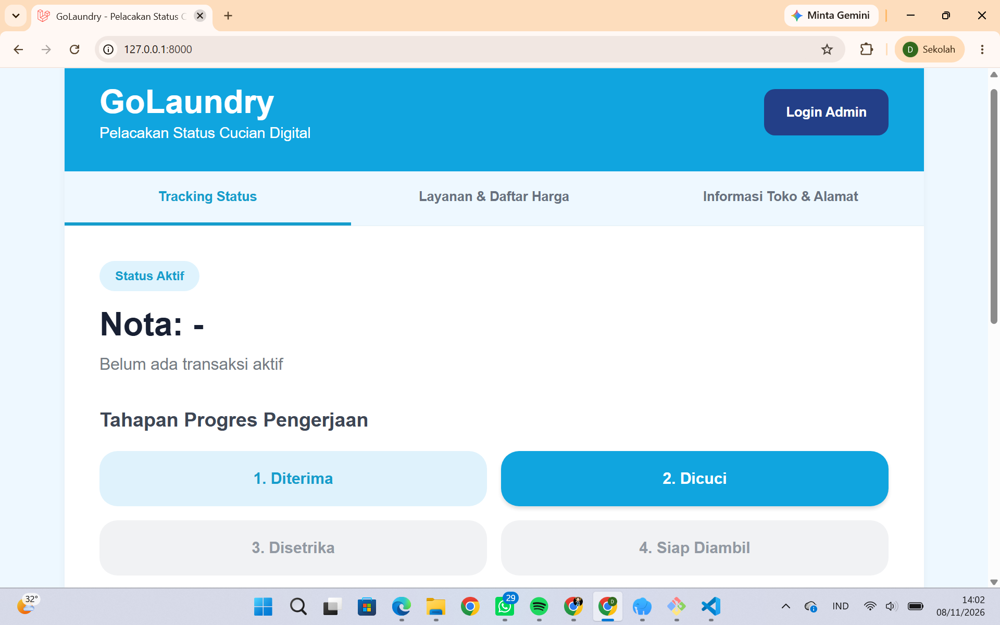

# GoLaundry

## Tentang Proyek

GoLaundry merupakan proyek pengembangan website layanan laundry yang bertujuan untuk mempermudah pelanggan dalam memperoleh informasi mengenai layanan laundry secara online.

Website ini dirancang agar pelanggan dapat mengenal layanan yang tersedia melalui tampilan halaman yang sederhana, menarik, dan mudah digunakan.

## Tujuan Proyek

Tujuan pembuatan GoLaundry adalah:
- Mempermudah pelanggan mendapatkan informasi layanan laundry.
- Memberikan kemudahan dalam mengakses informasi layanan secara online.
- Mengembangkan sistem layanan laundry berbasis website.
- Menerapkan teknologi web dalam membantu kegiatan usaha laundry.

## Fitur Website

Website GoLaundry dikembangkan dengan beberapa fitur yang disesuaikan dengan kebutuhan layanan laundry.

## Teknologi yang Digunakan

- Laravel
- PHP
- MySQL
- HTML
- CSS
- JavaScript

## Tampilan Landing Page

## Tema Proyek Kolaboratif

Tema proyek kolaboratif yang diambil adalah pengembangan website layanan laundry bernama GoLaundry. Proyek ini berfokus pada pembuatan platform berbasis website yang dapat membantu memberikan informasi dan kemudahan akses layanan laundry bagi pelanggan.

## Developer

- Dimas Surya Lesmana
- Moch. Revan Eka Permana

---

**Nama Proyek:** GoLaundry  
**Kategori:** Website Layanan Laundry  
**Framework:** Laravel